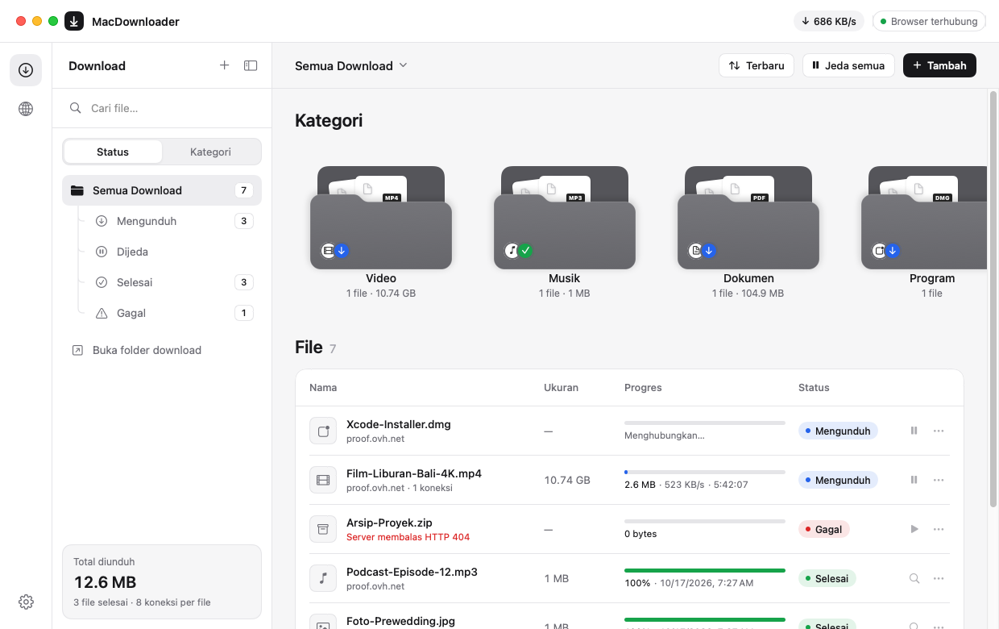
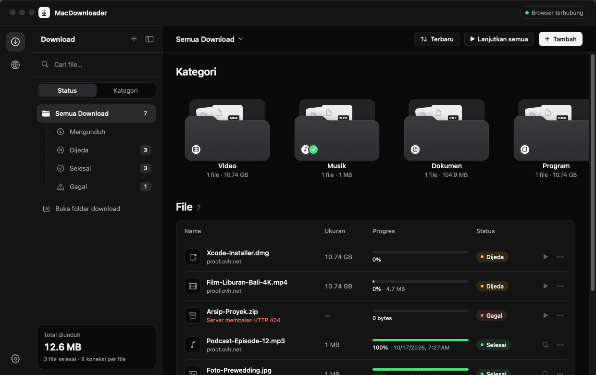

# MacDownloader

Download manager untuk macOS ala IDM: native SwiftUI, universal (Apple Silicon + Intel), macOS 13 ke atas. Tampilan monokrom dengan mode terang dan gelap yang mengikuti setelan Mac.





## Fitur

- **Download multi-koneksi.** File dipecah menjadi segmen yang diunduh paralel (default 8 koneksi, maksimal 32), masing-masing di koneksi TCP terpisah. Koneksi yang selesai lebih dulu mengambil alih setengah sisa segmen terbesar (work stealing), sehingga ujung download tidak tertahan oleh satu koneksi lambat.
- **Langsung ke disk.** Data ditulis ke posisinya di satu file (`pwrite`) yang ruangnya sudah dipesan di awal. Tidak ada file part dan tidak ada proses penggabungan. Kalau disk tidak cukup, download langsung ditolak di awal.
- **Pause/resume yang aman.** Progres tersimpan dan bisa dilanjutkan setelah restart. File di server divalidasi dengan `If-Range` (ETag/Last-Modified): kalau file di server berubah, download diulang, bukan disambung.
- **Tahan server yang membatasi.** Saat server menolak (429/503) atau koneksi gagal, jumlah koneksi dikurangi, lalu dinaikkan lagi bertahap saat server pulih.
- **Hemat baterai.** Mac dicegah tidur hanya selama ada download aktif (layar tetap boleh mati), dan pembaruan tampilan hanya berjalan saat ada transfer.
- **Ringkasan di atas daftar download:** kecepatan total dengan grafik semenit terakhir, jumlah download aktif dan antre, serta total yang terunduh hari ini.
- **Mode kecepatan** Penuh, Hemat, dan Senyap untuk semua download sekaligus, supaya video call atau streaming tetap lancar. Batas Hemat dan Senyap bisa diatur di Pengaturan › Download. Batasnya berlaku di jaringan (server ikut melambat), bukan sekadar menunda penulisan ke disk.
- **Ikon menu bar** untuk melihat progres, mengganti mode kecepatan, menjeda, atau melanjutkan download dengan cepat.
- **Pengaturan** di dalam jendela utama (⌘,): Umum (folder, buka saat login, cegah tidur), Download (koneksi, antrean, batas kecepatan), Integrasi, Tampilan (terang/gelap/ikut sistem), dan Tentang (cek update dari GitHub).
- **Dua bahasa: Indonesia dan English.** Pilih di Pengaturan › Tampilan (bawaan: ikut bahasa macOS). Ganti bahasa langsung berlaku tanpa restart, termasuk menu bar, notifikasi, pesan error, dan ekstensi browser.
- **Antrian & kategori.** Ada batas download bersamaan, dan file otomatis masuk ke subfolder Video, Musik, Dokumen, Program, Arsip, Gambar, atau Lainnya.
- **Integrasi browser** untuk Chrome, Edge, Brave, dan Arc: download diambil alih otomatis dan tersedia menu klik kanan. Cookie dan referrer ikut dikirim.

Detail teknis ada di [ARCHITECTURE.md](ARCHITECTURE.md).

## Instalasi

**Cara tercepat** — buka Terminal, tempel perintah ini, lalu Enter:

```
curl -fsSL https://raw.githubusercontent.com/mubaroksn/MacDownloader/main/install.sh | bash
```

Script mengunduh rilis terbaru, memasangnya ke **Applications**, lalu membuka app. Tidak ada peringatan Gatekeeper karena file yang diunduh lewat `curl` tidak diberi tanda karantina. Jalankan perintah yang sama untuk update.

**Manual lewat DMG**

1. Unduh `MacDownloader-x.y.z.dmg` dari **Releases**.
2. Buka DMG, lalu tarik **MacDownloader** ke **Applications**.
3. Pembukaan pertama: app ini ditandatangani ad-hoc tapi belum dinotarisasi Apple, jadi macOS menolaknya. Buka **System Settings → Privacy & Security**, gulir ke bawah, klik **Open Anyway**. (Di macOS 15 Sequoia ke atas, klik kanan → Open sudah tidak berlaku.)
   Alternatif lewat Terminal: `xattr -dr com.apple.quarantine /Applications/MacDownloader.app`

## Memasang ekstensi browser

1. Di app, buka **MacDownloader → Settings → Browser**, lalu klik **Siapkan ekstensi**.
2. Di browser, buka `chrome://extensions` (Edge: `edge://extensions`) dan aktifkan **Developer mode**.
3. Klik **Load unpacked**, lalu pilih folder `ChromeExtension` yang terbuka di Finder.

### Firefox

1. Buka halaman **Releases** dan unduh `MacDownloader-Firefox-<versi>.xpi`.
2. Seret file itu ke jendela Firefox (atau buka `about:addons` → ikon gerigi → **Install Add-on From File…**), lalu klik **Add**.
3. Kalau popup ekstensi menampilkan tombol **Izinkan akses ke semua situs**, klik sekali.

File `.xpi` ditandatangani Mozilla lewat CI (butuh secret `AMO_JWT_ISSUER` dan `AMO_JWT_SECRET`, kunci API gratis dari addons.mozilla.org). Tanpa itu, Release hanya berisi `MacDownloader-Firefox-<versi>.zip` yang bisa dipasang sementara lewat `about:debugging` → **Load Temporary Add-on**.

App berkomunikasi dengan ekstensi melalui `127.0.0.1:9614` dan hanya bisa diakses dari Mac itu sendiri.

## Membuat rilis

Buka tab **Actions → Build macOS app → Run workflow**, isi kolom versi (misalnya `1.0.1`), lalu jalankan. Atau push tag `v1.0.1`. GitHub Actions akan membuat Release berisi DMG dan zip ekstensi.

Setiap build juga menjalankan smoke test di Mac: aplikasi dibuka, lalu dites mengunduh file 10 MB lewat jalur ekstensi browser, dan hasilnya dicocokkan byte per byte.

Build dan tes lokal di Mac (butuh Xcode Command Line Tools):

```bash
swift test             # unit + integration test engine
scripts/build_app.sh   # hasil ada di dist/
```

Untuk mengembangkan di Xcode: buka `Package.swift` langsung (File › Open). Xcode menampilkan target `MacDownloader`, `DownloadCore`, dan `DownloadCoreTests`.

## Struktur

| File | Isi |
|---|---|
| `Sources/DownloadCore/` | Engine tanpa UI: probe, segmentasi, transfer paralel, penulisan disk |
| `Sources/MacDownloader/Downloads/` | Antrian, penyimpanan progres, notifikasi |
| `Sources/MacDownloader/Ingest/` | Pintu masuk download (ekstensi browser, dll.) |
| `Sources/MacDownloader/System/` | Manajemen daya (IOKit, App Nap) |
| `Sources/MacDownloader/UI/` | Tampilan SwiftUI dan menu bar |
| `Tests/DownloadCoreTests/` | Unit test dan tes end-to-end dengan server lokal |
| `ChromeExtension/` | Ekstensi browser (Manifest V3) — satu sumber untuk Chromium & Firefox (`scripts/build_extensions.sh`) |

## Terjemahan

Teks di kode ditulis dalam bahasa Indonesia dan dibungkus `L("...")` (Swift) atau `t("...")` (ekstensi). Terjemahan Inggris ada di `Localization/en.json`. Setelah mengubah teks, jalankan:

```
python3 scripts/l10n.py
```

Script itu membuat ulang `Strings.generated.swift` dan `ChromeExtension/strings.js`, dan gagal bila ada teks tanpa terjemahan, terjemahan yang tidak terpakai, atau format (`%ld`, `%@`) yang tidak cocok. CI menjalankan pemeriksaan yang sama di setiap build.
